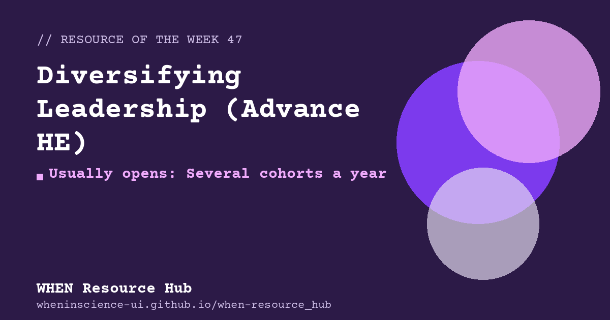
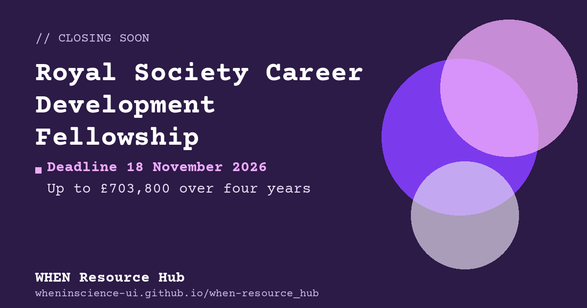

# Posts for the week of 16 November 2026

Bluesky: not connected, so nothing was posted (see README).
LinkedIn: copy the text below and attach the image (right click, save image).

## Resource of the Week 47



Image file: `social/2026-11-16-diversifying-leadership--advance-he.png`

```
Resource of the Week 47: Diversifying Leadership (Advance HE)

A leadership programme for racially minoritised staff in UK higher education, with action learning sets and an...

Usually opens: Several cohorts a year.

All details on the WHEN Resource Hub: https://wheninscience-ui.github.io/when-resource_hub/
#WHENResourceOfTheWeek
```

## Closing soon



Image file: `social/2026-11-16-royal-society-career-development-fellows.png`

```
2 days left: Royal Society Career Development Fellowship

A four-year fellowship for early-career researchers of Black heritage in the natural sciences at a UK host...

Deadline 18 November 2026. Up to £703,800 over four years.

All details on the WHEN Resource Hub: https://wheninscience-ui.github.io/when-resource_hub/
#WHENResourceOfTheWeek
```

