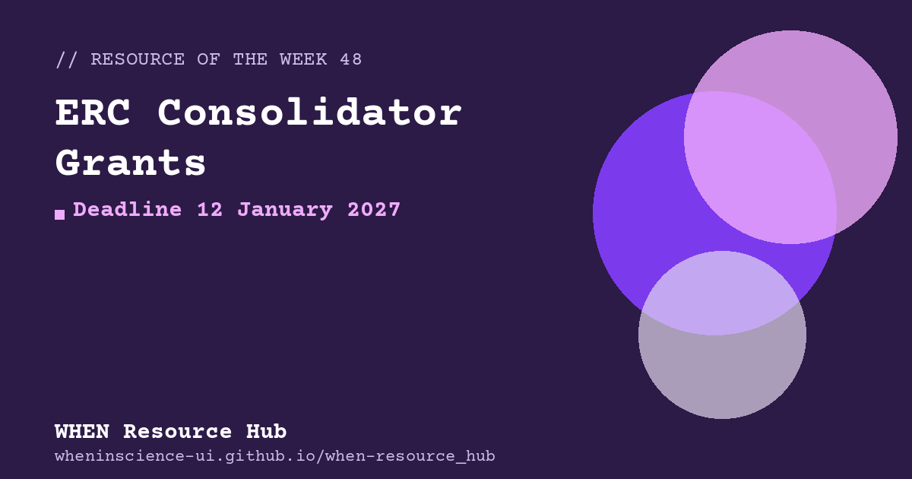

# Posts for the week of 23 November 2026

Bluesky: not connected, so nothing was posted (see README).
LinkedIn: copy the text below and attach the image (right click, save image).

## Resource of the Week 48



Image file: `social/2026-11-23-erc-consolidator-grants.png`

```
Resource of the Week 48: ERC Consolidator Grants

Up to five years of funding to consolidate an independent team and research programme at a host in Europe.

Deadline 12 January 2027.

All details on the WHEN Resource Hub: https://wheninscience-ui.github.io/when-resource_hub/
#WHENResourceOfTheWeek
```

